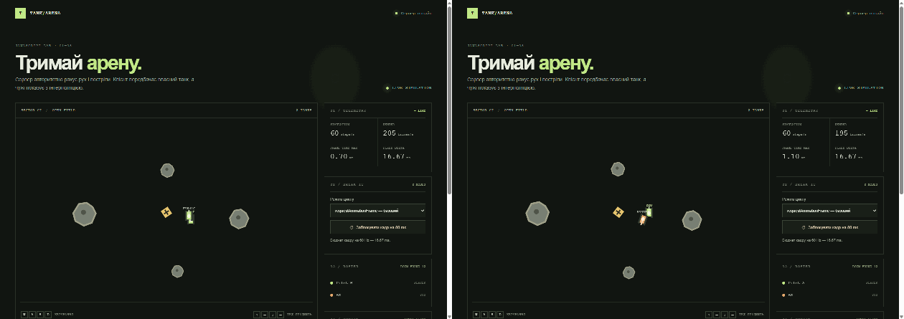

# Tank Arena

[](.github/workflows/ci.yml)

Навчальний танковий прототип на JavaScript: браузерний клієнт на Vite та
Node.js authoritative-сервер кімнат, симуляції й чату.

## Публічна версія та production-деплой

Production-образ збирається у кілька етапів, містить лише production-залежності,
запускається від непривілейованого користувача `node` і виконує Node напряму.
Локальний образ має розмір близько 188 MB. Він надає `/health` з build SHA,
`/ready` для перевірки готовності та Prometheus `/metrics`. PWA кешує статичну
оболонку; API та WebSocket не кешуються.
На Railway для збереження журналів між деплоями додайте Railway Volume з mount
path `/data`; `LOG_DIR` у контейнері заданий як `/data/logs`. Не додавайте
Dockerfile `VOLUME`: Railway відхиляє цю інструкцію під час валідації.

Workflow [release.yml](./.github/workflows/release.yml) публікує образ у GHCR для
тегів `lab-08` та `v*`. Для автоматичного деплою треба налаштувати secrets
`DEPLOY_WEBHOOK_URL` і, якщо цього вимагає хостинг, `DEPLOY_WEBHOOK_TOKEN`.
Хостинг має підтримувати Node-контейнер, WebSocket upgrade та HTTPS/WSS.
Задайте `ALLOWED_ORIGINS` точним origin вебсайту; `TRUST_PROXY=true` вмикайте
лише за наявності довіреного reverse proxy. Решта лімітів і змінних описані в
[.env.example](./.env.example).

Живої публічної адреси поки немає: цей workspace не має налаштованого
GitHub remote чи hosting provider. Тому зовнішній WSS, RTT між мережами,
теги `lab-08`/`v1.0.0` і відео захисту тут не заявляються як готові.

## Запуск

Для локальної розробки й тестів потрібен Node.js 22 або новіший.

```sh
npm install
npm run build
npm run server
```

Сервер віддає зібраний `client/dist`. Для розробки замість production build
запустіть Vite в іншому терміналі:

```sh
npm run dev
```

Відкрийте адресу Vite (типово `http://localhost:5173`), введіть ім’я та оберіть
кімнату. Щоб грати разом, приєднайтеся до однієї кімнати у двох вкладках.
Керування: `WASD` або стрілки, `Space` — вогонь, `Shift + Space` — homing-куля.
Стіни зупиняють танки й кулі; кам’яні перешкоди знищуються пострілами, а жовті
аптечки відновлюють 2 одиниці здоров’я (максимум — 5) і з’являються знову.
Сервер слухає порт `3001`, віддає `GET/POST /api/rooms`, `GET /health` і
WebSocket за `/ws`. `PORT` і `LOG_DIR` задаються через оточення; приклад є в
`.env.example`. У dev Vite проксує `/api` і `/ws`.

Корисні команди:

```sh
npm test
npm run lint
npm run format:check
npm run build
```

## Огляд восьми лабораторних (2 тижні)

| Лаба | Особливість JavaScript                             | Крок проєкту                                                                       |
| ---- | -------------------------------------------------- | ---------------------------------------------------------------------------------- |
| 1    | Event loop, microtask-и та `requestAnimationFrame` | Створити Vite-клієнт, фіксований крок симуляції й Canvas-рендер.                   |
| 2    | Об’єкти, прототипи, класи та `this`                | Зібрати `Vector2`, `Entity`, `Ship`, `World`, зіткнення та композиційні поведінки. |
| 3    | Promises, `async`/`await` та Web Audio             | Завантажувати assets асинхронно й додати лобі та звук.                             |
| 4    | Node.js, streams, `EventEmitter` та WebSocket      | Реалізувати кімнати, чат, журнал матчу й перепідключення.                          |
| 5    | Детермінізм, передбачення та `DataView`            | Перенести симуляцію на сервер і додати prediction та binary protocol.              |
| 6    | TypeScript, strict types та Zod                    | Типізувати спільну фізику, клієнт і сервер; перевіряти мережеві дані.              |
| 7    | Vitest, Playwright, профілювання та Worker         | Довести узгодженість тестами й виміряти продуктивність.                            |
| 8    | Production Node, Docker, PWA та метрики            | Підготувати безпечний контейнер, CI-реліз і публічний WSS-деплой.                  |

У перший тиждень виконайте лаби 1–4, у другий — 5–8. На кожній лабі
зафіксуйте короткий вимір або спостереження в README/звіті.

## Архітектура та теми курсу

- `client/src/physics.ts` містить чисту `integrate(tank, input, dt)` без DOM,
  мережі та побічних ефектів; це thin re-export із `shared/physics.ts`.
  Починаючи з лабораторної 5 ту саму функцію використовують браузерне
  передбачення й серверна симуляція.
- `client/src/loop.ts` накопичує час кадрів і викликає фізику з
  `FIXED_DT = 1 / 60` (16,67 ms), незалежно від частоти монітора. Рендер
  інтерполює між попереднім і поточним станом через alpha.
- `client/src/input.ts` замикає множину натиснутих клавіш усередині `createInput()`;
  зовнішній код отримує лише знімок стану керування.
- ES-модулі розділяють фізику, ввід, мережу, цикл і Canvas-рендерер. Клавіатурні
  події — task-и браузера; Promise callbacks та інші microtask-и виконуються
  перед наступним рендером. `requestAnimationFrame` викликається перед
  промальовуванням кадру, а зайва синхронна робота блокує і події, і рендер.
- Canvas масштабується за `devicePixelRatio`; координати симуляції залишаються
  сталими (960 × 600), а межі арени блокують вихід за ігрове поле.

## Лаба 2 — модель сутностей

`client/src/vector2.ts` містить незмінні за поведінкою вектори: арифметичні методи
повертають нові об’єкти. В `client/src/entities.ts`, `Ship extends Entity` — єдиний
рівень наслідування. `Entity` має приватний static `#nextId`, а корабель зберігає
здоров’я в `#hp` і відкриває його через getter. `client/src/world.ts` тримає сутності в
`Map<id, Entity>`, `ofKind()` є генератором, а `despawn()` позначає сутність
мертвою до `sweep()` наприкінці кроку. `client/src/collision-system.ts` окремо перевіряє
перетин кіл за O(n²). Кулі мають TTL; попадання створює частинки, знищений
локальний корабель відроджується за 2 секунди, а очки й HP показані в HUD.

Клавіша Space викликає корабель через функцію-обгортку:
`event => ship.fire(world, { homing: event.shiftKey })`. Якщо передати метод
безпосередньо як `addEventListener("keydown", ship.fire)`, браузер викличе його
як звичайний callback із `this`, що в ES-модулі буде `undefined`; читання
`this.dead` завершиться помилкою. Альтернативи: `ship.fire.bind(ship, world)`
створює функцію з прив’язаним `this`, або оголосити метод стрілкою як поле класу
(вона захоплює лексичний `this`, але створюється на кожному екземплярі). Обгортка
зручна тут, бо передає `world` і параметр homing явним чином.

П’ять орієнтирів для `this`: виклик `obj.method()` прив’язує `this` до `obj`;
звичайний виклик функції в ES-модулі має `this === undefined`; `new C()` прив’язує
`this` до нового екземпляра; `call`/`apply`/`bind` задають його явно; стрілкова
функція власного `this` не має й бере його з зовнішньої області. У консолі
перевірте ланцюжок: `Object.getPrototypeOf(ship) === Ship.prototype`,
`Object.getPrototypeOf(Ship.prototype) === Entity.prototype`, а далі
`Object.getPrototypeOf(Entity.prototype) === Object.prototype`.

Homing — це змінна поведінка `HomingBehavior`, складена в `Bullet`; pickup має
окрему `RepairPickup` поведінку і є `Pickup`, а не різновидом корабля. Ієрархія
на кшталт `Entity → MovingEntity → ArmedMovingEntity → HomingArmedMovingEntity`
із гілкою `Entity → ShipPickup` дублювала б ознаки руху, зброї й ефектів та
неправдиво стверджувала б, що pickup є кораблем. Композиція залишає коротку
ієрархію, а `Map` — головним реєстром; `Set` використовується для одночасно
натиснутих клавіш.

## Лаба 3 — асинхронність, ассети й лобі

Натискання Join створює `AudioContext` у межах жесту гравця, читає
`public/assets/manifest.json`, паралельно запускає `loadAll()` і лише після
`await loadAll(...)` створює рендерер та ігровий цикл. Поки файли надходять,
`loading-canvas` малює реальний progress bar і лічильник завершених файлів.
Корабель, куля й астероїд рендеряться з SVG sprite sheets; WAV буфери декодуються
на етапі завантаження.

`loadImage`, `loadAudio` і `loadJson` приймають `AbortSignal`. Їхні запити
перевіряють `response.ok`, мають timeout, до трьох повторів із exponential
backoff та jitter; HTTP 4xx не повторюються. `loadAll()` використовує
`Promise.all`, звітує про кожен файл та скасовує сусідні завантаження при помилці.
Помилка показує Retry або повернення в лобі, а не запускає напівініціалізовану
гру. Звук слухає `fired`, `hit` і `exploded` на окремій шині `EventTarget` з
`CustomEvent`; світ не імпортує аудіо або DOM/HUD.

Promise починається у стані `pending` і завершується рівно один раз — як
`fulfilled` із значенням або `rejected` з помилкою. Callback-и всередині
`.then()` повертають нові проміси: повернене значення стає fulfillment, а
кинута помилка поширює rejection до найближчого `.catch()`. `async` завжди
повертає Promise, а `await` — синтаксис для підписки на його результат, який
відновлює функцію як microtask; це різні записи того самого ланцюжка.

Лобі — `Lobby extends EventTarget`; його DOM окремо в `lobby-dom.ts`. Асинхронний
генератор опитує `GET /api/rooms` кожні 3 секунди тільки коли вкладка видима.
Кожен запит має `AbortSignal.timeout(2500)`, а Join скасовує цикл опитування.
Кімнатний конфіг визначає поле, перешкоди і позицію pickup; приєднання до кімнати
передається WebSocket-серверу.

### Sequential await проти concurrent Promise.all

Для N ассетів з часом завантаження `tᵢ`, послідовний цикл очікує приблизно
`Σtᵢ`, тоді як паралельне завантаження — приблизно `max(tᵢ)` (плюс накладні
витрати мережі/декодування). Заміри у браузері на локальному наборі ассетів:

| Метод                      | Файлів |      Час |
| -------------------------- | -----: | -------: |
| послідовний `await`        |      6 | 18,20 ms |
| конкурентний `Promise.all` |      6 |  7,10 ms |

Це один замір локальних файлів із `cache: "no-store"` у вбудованому браузері:
шести `fetch` з читанням тіла через `arrayBuffer()`, без декодування аудіо/зображень.
Повторіть із DevTools Network throttling: час залежить від мережі, кеша й
пристрою, тому для звіту зафіксуйте власні значення.

### П’ять головоломок: порядок виконання

Запускайте кожен фрагмент окремо в консолі. `sync` — поточний стек; Promise
continuations та відновлення після `await` — microtasks; `setTimeout` — task;
`requestAnimationFrame` — callback перед промальовуванням кадру.

1. **`await` робить продовження microtask**

   ```js
   console.log("A");
   async function run() {
     console.log("B");
     await 0;
     console.log("D");
   }
   run();
   console.log("C");
   ```

   Вивід: `A B C D`. `await` віддає керування стеку, а решта `run()` продовжується
   в microtask після поточного коду.

2. **Таймер усередині `.then()`**

   ```js
   Promise.resolve()
     .then(() => {
       console.log("A");
       setTimeout(() => console.log("C"), 0);
       console.log("B");
     })
     .then(() => console.log("D"));
   console.log("sync");
   ```

   Вивід: `sync A B D C`. Promise microtasks спорожнюються раніше, ніж event loop
   переходить до таймера-task, створеного з першого `.then()`.

3. **Promise microtask перед кадром**

   ```js
   console.log("sync");
   requestAnimationFrame(() => console.log("frame"));
   Promise.resolve().then(() => console.log("microtask"));
   ```

   Вивід до найближчого кадру: `sync microtask frame`. Microtask checkpoint
   завершується до наступного rendering opportunity і callback rAF.

4. **`await` з `Promise.all`**

   ```js
   async function run() {
     console.log("start");
     const values = await Promise.all([Promise.resolve(2), Promise.resolve(3)]);
     console.log(
       "sum",
       values.reduce((a, b) => a + b, 0),
     );
   }
   run();
   console.log("outside");
   ```

   Вивід: `start outside sum 5`. `Promise.all` чекає всі fulfilled значення, а
   продовження після `await` стає microtask.

5. **Помилка поширюється ланцюжком і відновлюється в `catch`**

   ```js
   Promise.reject(new Error("boom"))
     .catch((error) => {
       console.log("caught", error.message);
       return "recovered";
     })
     .then((value) => console.log(value));
   console.log("sync");
   ```

   Вивід: `sync`, потім `caught boom`, потім `recovered`. Відхилення передається
   вниз до найближчого `catch`; повернене значення перетворює ланцюжок назад на
   fulfilled.

`Promise.all` зупиняється на першій помилці; `allSettled` збирає результат кожного
запиту; `race` завершується першим settled промісом (корисно для дедлайну);
`any` повертає перший fulfilled і відхиляється `AggregateError`, лише якщо всі
запити відхилені. У `Lobby` використано асинхронний генератор `updates(signal)`,
щоб віддавати послідовні результати опитування як async iterable.

### Галерея збоїв і відновлення

У DevTools Network або тимчасово редагуючи запис manifest перевірте кожен
сценарій:

| Збій                       | Як відтворити                                                                       | Очікувана поведінка                                                                                                                        |
| -------------------------- | ----------------------------------------------------------------------------------- | ------------------------------------------------------------------------------------------------------------------------------------------ |
| 404 спрайта                | Підставити для `tank` URL `/assets/missing.svg`                                     | `HttpError 404`, без повтору для 4xx; паралельні файли скасовуються, гра не стартує, з’являється Retry. Повернути URL і натиснути Retry.   |
| Таймаут мережі             | Увімкнути Offline/Slow 3G під час завантаження або опитування лобі                  | Запит обривається за timeout; asset-запит повторюється з backoff, а після ліміту можна Retry. Лобі показує помилку й продовжує опитування. |
| Abort посеред завантаження | Натиснути «Назад до лобі» під час завантаження                                      | `AbortController` зупиняє manifest/assets; жоден цикл гри не стартує, лобі знову доступне.                                                 |
| Битий JSON                 | Підмінити в Network відповідь `/assets/manifest.json` або `/api/rooms` на `{broken` | Parser error не валить застосунок: для manifest доступна кнопка Retry; лобі показує помилку та спробує знову на наступному poll.           |

Усі обробники асинхронних помилок показують помилку явно; відхилення не маскуються
порожнім списком ассетів чи фальшивим успішним результатом.

## Три експерименти: зламай і виміряй

Панель `BREAK IT` перемикає цикл без перезавантаження. Порівнюйте лічильники
`steps/s`, `frames/s` та `frame time`; результат залежить від браузера, монітора,
навантаження й активної вкладки. Запишіть свої виміри разом із моделлю пристрою.

Контрольний запуск у вбудованому браузері цього проєкту дав такі приклади:
`requestAnimationFrame` — 200 frames/s і 60 steps/s; `setInterval` — 63 frames/s
і 61 steps/s. Без навмисного блокування час кадру був близько 0,10 ms; після
блокування на 80 ms HUD показав максимум 80,20 ms. Це один запуск на конкретному
середовищі, не гарантована характеристика; інші монітори та браузери дадуть інші
значення.

| Експеримент                 | Що зробити                                    | Числовий орієнтир і пояснення                                                                                                                                                                                                                                               |
| --------------------------- | --------------------------------------------- | --------------------------------------------------------------------------------------------------------------------------------------------------------------------------------------------------------------------------------------------------------------------------- |
| Блокування головного потоку | Натиснути «Заблокувати кадр на 80 ms»         | 80 ms / 16,67 ms ≈ 4,8 бюджетів кадру: на дисплеї 60 Hz це може пропустити близько 4–5 кадрів. Поки виконується синхронний цикл, event loop не обробляє input tasks, microtasks чи rAF.                                                                                     |
| Таймер замість rAF          | Вибрати `setInterval`                         | Інтервал 16,67 ms дає теоретично 60 викликів/с, але це не синхронізує рендер із дисплеєм. Таймери мають джиттер і throttling; перевірте фактичний `frames/s` на 60/120 Hz.                                                                                                  |
| Змінний крок                | Вибрати «Змінний крок» і натиснути блокування | Після паузи 80 ms симуляція робить один крок приблизно на 80 ms замість 5 кроків по 16,67 ms. Положення, швидкість та обертання танка відчутно змінюються з `dt`, тому довгі кадри дають нерівномірну фізику. Фіксований крок обмежує dt та робить симуляцію відтворюваною. |

Блокування навмисне діє лише в браузері. У цій лабораторній сервер не виконує
ігрову фізику й не отримує координати.

## Лаба 4 — Node.js, кімнати та потоки

Репозиторій — npm workspace з `client/` і `server/`. Корінь задає спільні
scripts і dev-залежності; кожен пакет має власний `package.json`. Серверні
налаштування читаються з `PORT` і `LOG_DIR`, перевіряються в `server/config.ts`.
ESM активовано через `"type": "module"`; у Node ESM використовуються `import` і
`export`, а CommonJS-альтернатива має `require()` та `module.exports`. Браузер
також виконує ES-модулі, але не надає Node API на кшталт `node:http`, `Buffer`
або `node:fs`.

HTTP API:

| Маршрут                       | Поведінка                                                     |
| ----------------------------- | ------------------------------------------------------------- |
| `GET /health`                 | Стан сервера, кількість кімнат і сокетів                      |
| `GET /api/rooms`              | Поточні кімнати й arena config                                |
| `POST /api/rooms`             | Створення кімнати з JSON `{ "name": "...", "maxPlayers": 8 }` |
| `GET /api/matches/:id/replay` | NDJSON replay як stream                                       |
| `GET /` та статичні файли     | Віддача зібраного `client/dist`                               |
| `ws://host/ws`                | Join, leave, chat та з лабораторної 5 input/state протокол    |

`Room extends EventEmitter`; останній вихід гравця видаляє кімнату, а початкові
кімнати знову з’являються в лобі при наступному запиті. До WebSocket join дається
5 секунд; сервер перевіряє тип і форму повідомлення, payload до 4 KiB, частоту
до 60 повідомлень/с та відправляє ping кожні 15 секунд. Два пропущені pong
закривають з’єднання. Повідомлення не надсилається клієнту, якщо його
`bufferedAmount` перевищив ліміт 64 KiB. Клієнтська обгортка має FIFO-чергу та
reconnect із exponential backoff і jitter.

HTTP body читається частинами як Node `Buffer`; розмір JSON обмежений. Статика й
replay не читаються цілком у пам’ять: `createReadStream()` передається в
`pipeline()`, яка поширює помилки й зупиняє читання джерела під час backpressure
від повільного response. Match logger формує NDJSON через `Transform` і пише
його в файл потоком. `SIGINT`/`SIGTERM` закривають сокети та дочікуються pipeline,
щоб дописати журнал перед виходом.

### RSS під час повільного replay

Вимір: сервер запущено окремим Node-процесом; replay-файл — 64 MiB; клієнт
читав response через Web Streams із 2 ms паузою після кожного chunk; RSS сервера
знімався кожні 100 ms. Передача тривала близько 8 s. RSS мав bounded sawtooth
через GC і буфери сокета, а не ріс на розмір файла:

```text
секунда:  0    1    2    3    4    5    6    7
RSS MiB: 51   55   64   73   59   68   77   58
          ▁    ▁    ▄    ▇    ▂    ▅    █    ▂
```

У цьому запуску спостережений діапазон був 51–78 MiB (27 MiB між мінімумом і
піком); це один замір на Windows/Node 24.18.0, а не універсальна константа.
Принципова різниця зі `readFile()` — пам’ять обмежується буферами потоку/socket,
а не розміром NDJSON-файла.

### Затримка event loop і `EventEmitter` error

Node.js виконує JavaScript callbacks в одному потоці. Якщо HTTP handler
синхронно крутить цикл 300 ms, event loop не може обробити інші запити, WebSocket
повідомлення й таймери; усі вони чекають, а затримка ping може спричинити
від’єднання клієнта. У фазах libuv timers обробляються таймери, poll чекає та
виконує I/O callbacks, check виконує `setImmediate`, а close callbacks
обробляють закриття ресурсів. Promise callbacks — microtasks і виконуються між
JavaScript callbacks; `process.nextTick()` має окрему, пріоритетну чергу Node.

У `EventEmitter` подія з назвою `"error"` спеціальна: якщо її emit-нути без
слухача, Node кидає помилку синхронно, що зазвичай завершує процес. Тому `Room`
має error listener, який явно записує помилку; помилка logger-а передається в
кімнату, а не губиться. Це відрізняється від звичайної події, яку можна emit-нути
без жодного listener-а.

Лабораторна 4 передавала лише кімнату й чат. У лабораторній 5 координати від
клієнта й далі не приймаються: сервер обчислює їх сам із вхідних команд.

## Лаба 5 — серверна симуляція, reconciliation і бінарний протокол

`shared/` містить фізику та симуляцію без DOM і Node API. `client/src/physics.ts`
є re-export-ом спільного `integrate()`. Обидва середовища використовують
`SERVER_DT = 1 / 30`; на сервері кожен наступний tick планується через
`setTimeout` від цільового монотонного часу (`performance.now()`), а не через
`setInterval`. Кожен гравець надсилає input з монотонним `seq`: forward,
backward, left, right, fire і homing. Сервер ігнорує координати клієнта,
симулює танки та кулі, обробляє влучання/HP/score/respawn, а знімки містять
підтверджений `ack`.

Seed створюється сервером для кожної кімнати та використовується seeded PRNG
для spawn-позицій. `integrate()` не читає `Math.random()` або `Date.now()`; час
знімка потрібен лише для телеметрії. Для перевірки повторюваності два незалежні
екземпляри `ArenaSimulation` у тесті отримують однаковий seed/input і після
60 кроків мають тотожний стан.

Клієнт передбачає власний танк негайно, зберігає input history, а після знімка
переставляє локальний стан на серверний і повторює input з `seq > ack`.
Різниця між старим прогнозом і повторно обчисленим станом плавно зникає за
100 ms. Інші танки відображаються за останніми знімками з інтерполяцією на
100 ms у минулому. Своя куля створюється локально одразу; server bullet замінює
її після підтвердження. Netgraph показує RTT, вік знімка, поточні bytes/s,
чергу непідтверджених input та величину поправки.

Для наочного порівняння режимів додайте до адреси:

| Параметр                                  | Режим                                                    |
| ----------------------------------------- | -------------------------------------------------------- |
| `?prediction=off`                         | рух тільки після snapshot; відчутна затримка під мережею |
| `?netDelay=100`                           | штучні 100 ms у напрямках input і snapshot               |
| `?netDelay=100&netJitter=20&netLoss=0.02` | 100 ms затримки, ±20 ms jitter, 2% втрат                 |
| `?protocol=json`                          | текстовий JSON замість binary DataView                   |

Наприклад, відкрийте два вікна в одній кімнаті під однаковою штучною мережею:
перше з `?netDelay=100&netJitter=20&netLoss=0.02&prediction=off`, друге —
`?netDelay=100&netJitter=20&netLoss=0.02`. Нижче — запис двох клієнтів у
спільній кімнаті під час руху з увімкненим передбаченням:



### JSON проти DataView

Input packet має версію, тип, `seq` і бітові прапорці. Snapshot має версію, tick,
ack, server timestamp, кількість танків/куль; кути кодуються як signed `Int16`
у діапазоні `[-π, π]`. Усі багатобайтові поля — little-endian. DataView offsets
та розміри перевіряються тестами; невідома версія, некоректна довжина чи
зарезервовані input bits відхиляються.

| Прикладний пакет            |   JSON | Бінарний | Примітка                                      |
| --------------------------- | -----: | -------: | --------------------------------------------- |
| Один input                  |  122 B |      7 B | версія + тип + uint32 seq + flags             |
| Snapshot на 2 танки, 4 кулі | 1007 B |    160 B | 16 B header + 2 × 24 B tank + 4 × 24 B bullet |

Це вимірювання `JSON.stringify` і DataView encoder-а для двох UUID tank IDs,
чотирьох bullet records з TTL/color/owner ID, одного input і конкретних JSON
полів. Для власного
порівняння відкрийте однакову кімнату двічі й порівняйте
`TRAFFIC` у netgraph або виміряйте `JSON.stringify(state).length` і
`encodeSnapshotPacket(state, playerId).byteLength`. JSON зручний для інспекції,
але повторює імена полів та числа як текст; binary компактніший і вимагає
спільної версії/схеми на клієнті й сервері.

### Підсумок вимірів і модель довіри

| Режим                                 | Спостереження                                                                                             |
| ------------------------------------- | --------------------------------------------------------------------------------------------------------- |
| 100 ms затримки, prediction вимкнено  | рух видно після відповіді сервера; затримка до керування приблизно один RTT                               |
| 100 ms затримки, prediction увімкнено | танк починає рух локально; поправки netgraph показують відхилення після snapshot                          |
| Чужий танк                            | рендериться на 100 ms позаду за двома сусідніми snapshots                                                 |
| Чит                                   | клієнт може намалювати довільну позицію локально, але сервер її не прийме; приймає тільки обмежений input |

Щоб спостерігати помилку недетермінізму, тимчасово додайте невеликий
`Math.random()` зсув у shared `integrate()` та перезавантажте два клієнти:
прогнози більше не збігаються, і поправка з’являється на кожному snapshot.
Після виміру видаліть цей рядок: випадковість має надходити лише із seeded PRNG,
а не з глобального генератора браузера/Node.

## Лаба 6 — TypeScript і перевірка меж

`shared/`, `client/` і `server/` використовують TypeScript зі `strict` та
`noUncheckedIndexedAccess`; `npm run typecheck` перевіряє код цих пакетів.
Спільні `Vector2`-координати оголошені як `readonly`, а `EntityId`,
`SimulationStep` і `InputSequence` — branded-типи: попри однакове внутрішнє
представлення, ID не можна випадково передати як номер кроку або input sequence.
Знімки й мережеві повідомлення мають дискримінатори `kind` / `type`, а обробники
закривають `switch` через `never`.

TypeScript допоміг виявити переплутані рядкові ID і branded ID, неповні
discriminated-union обробники, небезпечне використання nullable/неперевірених
значень та невідповідні типи результатів асинхронного закриття кімнати. Усі
дані з мережі залишаються `unknown` до перевірки Zod; TypeScript стирається під
час збірки і не замінює runtime-валидацію. Бінарний decoder окремо перевіряє
версію, довжину, прапорці та числові межі пакета.

Фреймворк для UI не вводили: лобі й HUD невеликі, а Canvas та ігровий цикл
лишилися прямими модулями. У такий спосіб TypeScript додає перевірку контрактів,
не змінюючи модель рендерингу чи поведінку гри.

## Лаба 7 — тести, профілювання та навантаження

`npm test` запускає 33 legacy Node-тести й 57 Vitest-тестів у client/server/shared;
fast-check перевіряє протокольні round-trip, довжини пакетів, malformed buffers,
межі арени, вхідні повідомлення та детермінізм. У shared покриття — 94,07% рядків
(238/253), вище цілі 85%. Playwright відкриває два браузери в одній кімнаті й
перевіряє рух та доставку чату. CI запускає typecheck, lint, тести, build і цей E2E.

Кулі й частинки повторно використовуються з пулів після `sweep()`. Станові
вектори сутностей оновлюються на місці; ігровий крок перевикористовує масив
сутностей, а рендерер — точку інтерполяції. Тести перевіряють повторне
використання об’єктів і незмінну ідентичність векторів між кроками.

### Профіль 8 браузерів, 30 секунд

| Метрика                              |                    До |              Після |
| ------------------------------------ | --------------------: | -----------------: |
| Frame time p50                       |               16,7 ms |            16,7 ms |
| Frame time p95                       |               33,4 ms |            16,8 ms |
| Frame time p99                       |               50,0 ms |            33,3 ms |
| Найдовший кадр                       |               83,4 ms |            50,0 ms |
| Long tasks                           |         4 (max 70 ms) |      1 (max 63 ms) |
| Node GC pauses (count / total / max) | 133 / 117,1 / 18,6 ms | 30 / 77,0 / 8,8 ms |
| Серверний крок p99 (8 гравців)       |              0,299 ms |           0,339 ms |

Фінальний запуск покращив p95, p99, найдовший кадр і кількість long tasks, але
ціль `p99 < 16,7 ms` **не досягнута**. Повторні post-запуски мали p99 від
16,8 до 49,9 ms, тож середовище шумне. Frame time зведено з восьми окремих
headless Chromium-вікон; p99 включає планування ОС/браузера, а не лише симуляцію.
V8 CPU/heap sampling робився на першій вкладці; production bundle minified.
Найбільше sampled allocation у фінальному профілі — `(V8 API)` (675 kB) і
`(anonymous)` (590 kB); це оцінка байтів, не кількість об’єктів і не надійна
ідентифікація вихідної функції. GC-таблиця — це `node:perf_hooks` на сервері,
**не** паузи браузерного GC. Дані й графіки:
[до](./docs/performance-before.json), [після](./docs/performance-after.json),
[flame chart до](./docs/flame-before.png) та
[flame chart після](./docs/flame-after.png).

### Серверне навантаження

`npm run bench:clients` підключає 8, 32, 64 і 128 WebSocket-ботів до однієї
кімнати. Боти надсилають бінарний forward+right+fire input на 30 Hz; для
навантажувального сценарію кімната підтримує до 128 гравців. У 10-секундних
вимірах жоден крок не перевищив бюджет 33,3 ms:

| Клієнти | Крок p50 |      p95 |      p99 |      max | Кроки >33,3 ms |
| ------: | -------: | -------: | -------: | -------: | -------------: |
|       8 | 0,065 ms | 0,129 ms | 0,203 ms | 0,719 ms |              0 |
|      32 | 0,120 ms | 0,187 ms | 0,221 ms | 0,326 ms |              0 |
|      64 | 0,160 ms | 0,267 ms | 0,313 ms | 0,335 ms |              0 |
|     128 | 0,361 ms | 0,615 ms | 0,702 ms | 0,935 ms |              0 |

Це час симуляції кімнати, не доставка всіх snapshot клієнтам. Навіть при 128
гравцях вузьке місце не в перевірці колізій, тож просторовий хеш не додавався.
Повний звіт із затримкою event loop збережено в
[docs/load-test.json](./docs/load-test.json).

Для worker-експерименту `npm run bench:worker` переносить спільну симуляцію 8
ботів у браузерний Web Worker і порівнює з main thread (1200 кроків):
виміряний час — 12,3 ms на main thread і 10,6 ms у worker; найбільше
запізнення 10 ms таймера main thread — 3,0 ms проти 0,4 ms під час worker run.
Експеримент збережено в [docs/worker-benchmark.json](./docs/worker-benchmark.json).
Worker не підключено до звичайного gameplay: там клієнт передбачає лише один
танк на 30 Hz, а 1,7 ms різниці на штучному batch не виправдовують асинхронне
передавання стану та затримку керування. Повторіть профіль на цільовому
пристрої, якщо main thread стане CPU-bound.

Перевірки, які виконує CI:

```sh
npm run typecheck
npm test
npm run lint
npm run build
npm run test:e2e
```
